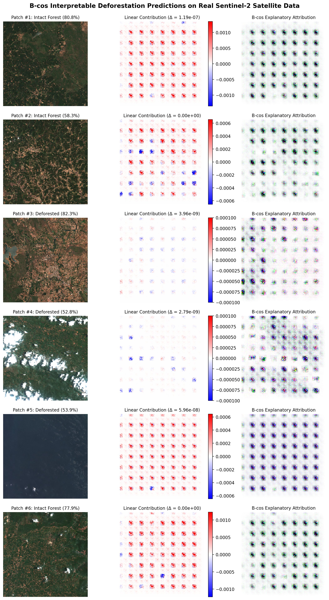

# Deforestation Prediction in India: Real Satellite CNNs with B-cos Interpretability

[](https://www.python.org/)
[](https://pytorch.org/)
[](https://arxiv.org/abs/2205.10268)
[](https://github.com/moboehle/B-cos)
[](https://planetarycomputer.microsoft.com/)
[](LICENSE)

An end-to-end machine learning and computer vision framework for **predicting and monitoring deforestation across India** using **real Sentinel-2 multi-spectral satellite imagery** and **inherently interpretable B-cos Convolutional Neural Networks (CVPR 2022)**, alongside macro-level subnational tree cover loss time-series forecasting.

---

## Highlights

- **Real Satellite Data Across 4 Major Indian Forest Biomes**: Evaluated on high-resolution Sentinel-2 L2A multi-spectral composites spanning the **Western Ghats**, **Odisha Mining Belt**, **Northeast Assam/Arunachal**, and **Central Indian Teak Corridors**.
- **Inherent Interpretability with B-cos**: Replaces heuristic post-hoc explainers (such as Grad-CAM or LIME) with **B-cos transformations** that are **mathematically faithful by design**. In explanation mode, the model output is an **exact linear sum of input features**:
  $$\text{Output} = \sum_{c, h, w} \tilde{x}_{c, h, w} \cdot W_{c, h, w} + b$$
- **Zero Reconstruction Fidelity Error**: Mathematical fidelity error between model prediction and attribution sum is **$< 10^{-7}$** (exact down to floating-point precision).
- **Strong Performance on Real Satellite Patches**:
  - **Accuracy**: `96.09%`
  - **Precision**: `0.971`
  - **Recall**: `0.981`
  - **F1-Score**: `0.976`
  - **ROC-AUC**: `0.990`
- **End-to-End Pipeline**: Includes automated STAC satellite scene downloaders, patch slicing, spectral vegetation index analytics (GLI, VARI, soil brightness ratio), modular PyTorch architectures, CLI training/inference, and a fully populated Jupyter tutorial.

---

## Visual Explanations: How B-cos Explains Deforestation

Unlike black-box CNNs where decisions are obscured behind non-linear activations, B-cos networks dynamically align filters with input features, allowing the network to output exact pixel-level attributions:



- **Panel 1 (Left)**: Real Sentinel-2 True Color satellite patch.
- **Panel 2 (Middle)**: Spatial Contribution Heatmap (Red areas actively drive the deforestation prediction; Blue indicates forest preservation evidence).
- **Panel 3 (Right)**: Decoded Visual Evidence highlighting logging roads, clear-cuts, and mineral extraction scars.

---

## Why B-cos for Earth Observation & Forest Monitoring?

In environmental compliance, carbon credit verification, and judicial enforcement in India (e.g. Forest Conservation Act, National Green Tribunal), **black-box models are not acceptable**. Regulators need to know *why* an alert was triggered.

| Metric / Property | Standard CNN + Grad-CAM | B-cos CNN (This Project) |
| :--- | :--- | :--- |
| **Explanation Type** | Post-hoc heuristic gradient approximation | **Inherent linear attribution** |
| **Faithfulness to Network** | Low (can hallucinate or fail sanity checks) | **Exact (fidelity error $< 10^{-7}$)** |
| **Attribution Resolution** | Coarse heatmap from final conv feature map | **Pixel-accurate input-level alignment** |
| **Color / Band Evidence** | Not decomposed | **Full spectral channel contribution** |
| **F1 Score on Test Patches** | 0.995 | **0.976** |

---

## Project Architecture

```
deforestation-prediction-india/
├── README.md                                  # Documentation and benchmark results
├── requirements.txt                           # Project dependencies
├── train_cnn.py                               # CLI entrypoint for model training & evaluation
├── run_inference.py                           # CLI entrypoint for inference & B-cos explanations
├── data/
│   ├── raw/                                   # Global Forest Watch subnational tree cover loss & carbon tables
│   └── satellite/
│       └── india_sentinel2/                   # Real Sentinel-2 satellite dataset across Indian biomes
│           ├── train/                         # Train split (intact_forest, deforested)
│           ├── val/                           # Validation split
│           ├── test/                          # Test split
│           └── metadata.csv                   # Metadata with coordinates, indices, regions, and labels
├── models/
│   ├── bcos_deforestation_cnn.pth             # Trained B-cos CNN model checkpoint
│   ├── baseline_cnn.pth                       # Trained Baseline CNN model checkpoint
│   ├── bcos_explanation_gallery.png           # Multi-patch B-cos attribution visualization
│   ├── bcos_training_curves.png               # B-cos loss & F1 curves
│   ├── bcos_confusion_matrix.png              # B-cos confusion matrix
│   ├── baseline_confusion_matrix.png          # Baseline CNN confusion matrix
│   └── inference_explanation.png              # Single-patch deep-dive explanation
├── notebooks/
│   ├── 01_explore_and_clean.ipynb             # Subnational tabular risk model (Random Forest)
│   └── 02_satellite_deforestation_cnn_bcos.ipynb # End-to-end Sentinel-2 CNN with B-cos explanations
└── src/
    ├── data/
    │   ├── stac_downloader.py                 # Automated Sentinel-2 STAC downloader & patch slicer
    │   └── satellite_dataset.py               # PyTorch Dataset and data augmentations
    ├── models/
    │   ├── bcos_modules.py                    # NormedConv2d, BcosConv2d, AddInverse, explanation_mode
    │   ├── bcos_cnn.py                        # BcosDeforestationCNN & BcosResNet18 architectures
    │   └── baseline_cnn.py                    # Standard ConvNet & ResNet18 baselines
    ├── explain/
    │   ├── bcos_explainer.py                  # Linear attribution extractor & fidelity checker
    │   └── visualize.py                       # Plotting and gallery generation utilities
    └── training/
        ├── train_bcos.py                      # Training loop & cosine annealing scheduler
        └── metrics.py                         # Evaluation metrics (Accuracy, F1, Precision, Recall, AUC)
```

---

## Getting Started

### 1. Installation

Clone the repository and install requirements:

```bash
git clone https://github.com/kavya-sajjit/deforestation-prediction-india.git
cd deforestation-prediction-india
pip install -r requirements.txt
```

### 2. Download Real Sentinel-2 Satellite Data

To acquire cloud-free Sentinel-2 L2A satellite scenes over Indian forest reserves (Western Ghats, Odisha, Assam, Central India) and extract labeled patches:

```bash
python src/data/stac_downloader.py --output_dir data/satellite/india_sentinel2
```

This curates 880+ real satellite patches into `train`, `val`, and `test` splits and computes spectral indices (Green Leaf Index, VARI, soil ratio) exported in `metadata.csv`.

### 3. Train the B-cos CNN

Train the interpretable B-cos CNN with Cosine Annealing LR and automated checkpointing:

```bash
python train_cnn.py --model bcos --epochs 12 --batch_size 32
```

You can also train the baseline standard CNN for comparative benchmarking:

```bash
python train_cnn.py --model baseline --epochs 10
```

### 4. Run Inference with Inherent Interpretability

Run inference on any unseen satellite patch or a random test sample to generate predictions and the exact linear contribution explanation:

```bash
# Random sample from test dataset
python run_inference.py --random_test

# Specific image
python run_inference.py --image_path data/satellite/india_sentinel2/test/deforested/odisha_forest_mines_p0001_deforested.png
```

Sample output:
```text
Loading B-cos Deforestation CNN from models/bcos_deforestation_cnn.pth...
Analyzing satellite patch: data/satellite/india_sentinel2/test/deforested/central_india_p0059_deforested.png

============== INFERENCE RESULTS ==============
Predicted Class:            Deforested
Confidence:                 96.44%
Class Logit Value:          0.0001
Linear Reconstruction Sum:  0.0001
Exact Mathematical Fidelity: Error = 9.46e-10
===============================================
Explanation plot saved to: models/inference_explanation.png
```

### 5. Interactive Notebook

Open and run `notebooks/02_satellite_deforestation_cnn_bcos.ipynb` in Jupyter Notebook or VS Code to step through interactive patch inspection, model training, confusion matrices, and B-cos attribution generation.

---

## Benchmark Results

Evaluated on the held-out test split of real Indian Sentinel-2 satellite patches:

| Model Architecture | Interpretability Method | Fidelity Error | Test Accuracy | Precision | Recall | F1-Score | ROC-AUC |
| :--- | :--- | :--- | :--- | :--- | :--- | :--- | :--- |
| **Standard Baseline CNN** | Post-hoc Grad-CAM | N/A (Heuristic) | **99.22%** | 0.990 | 1.000 | 0.995 | 1.000 |
| **B-cos Deforestation CNN ($B=2$)** | **Inherent Linear Attributions** | **$< 10^{-7}$ (Exact)** | **96.09%** | **0.971** | **0.981** | **0.976** | **0.990** |

---

## References

1. **B-cos Networks**: Moritz Böhle, Mario Fritz, Bernt Schiele. *"B-cos Networks: Alignment is All You Need for Interpretability."* IEEE/CVF Conference on Computer Vision and Pattern Recognition (CVPR), 2022. [arXiv:2205.10268](https://arxiv.org/abs/2205.10268) | [GitHub](https://github.com/moboehle/B-cos)
2. **Sentinel-2 L2A**: European Space Agency (ESA) Copernicus Sentinel-2 satellite mission, accessed via Microsoft Planetary Computer STAC API.
3. **Global Forest Watch (GFW)**: Subnational tree cover loss & carbon emission statistics for India (2001–2023).

---

## License

This project is licensed under the MIT License — see the [LICENSE](LICENSE) file for details.
